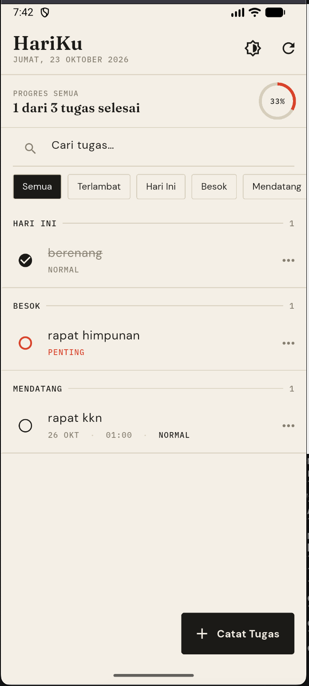
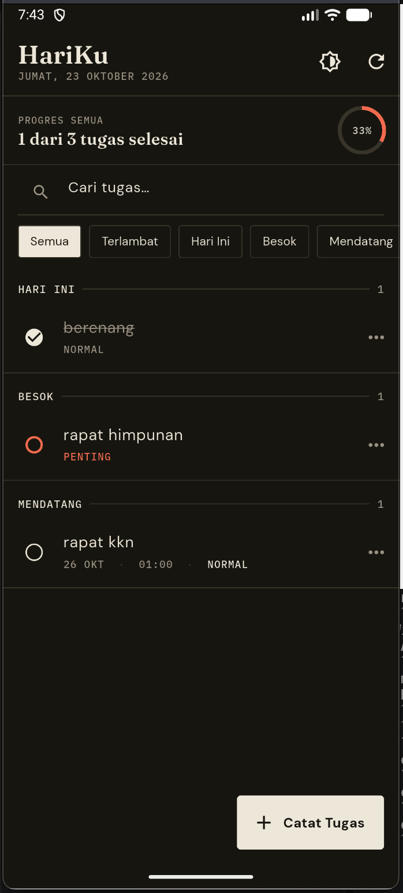
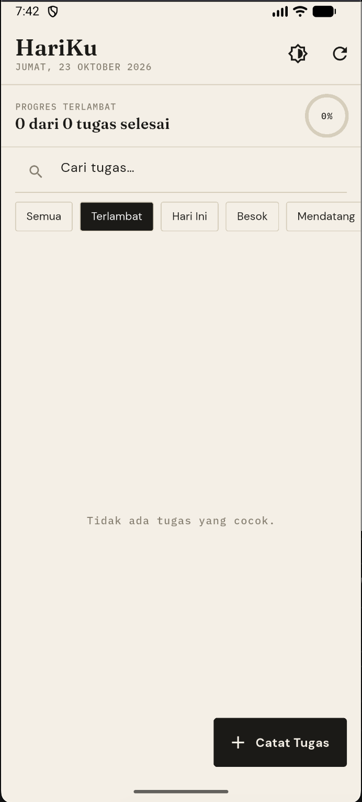
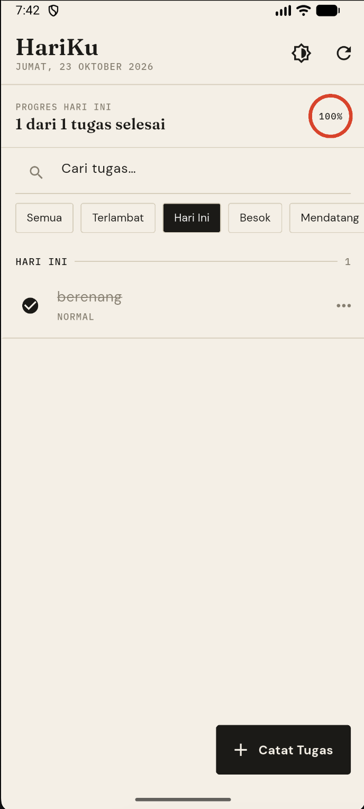
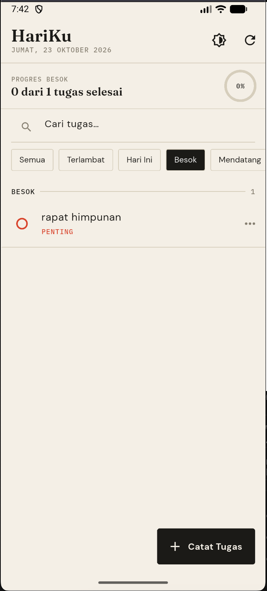
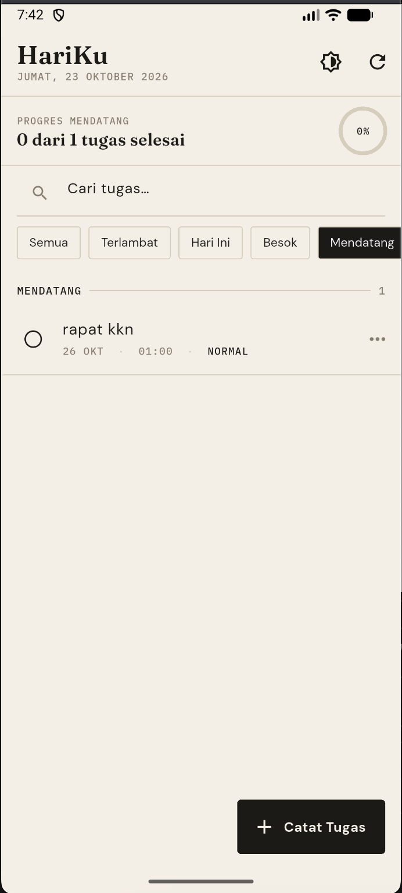

# HariKu 📝

> **Aplikasi Manajemen Tugas Harian Berbasis Flutter dengan Pemanfaatan Todoist REST API, FutureBuilder, dan Notifikasi Lokal.**

Dokumentasi Proyek Ujian Tengah Semester (UTS) — Matakuliah Pemrograman Mobile (Kelas C)  
Program Studi Teknik Informatika, Fakultas Sains dan Teknologi  
Universitas Islam Negeri Maulana Malik Ibrahim Malang  
Tahun Akademik 2026

---

## 📱 Tangkapan Layar Aplikasi (Screenshots)

Berikut adalah tampilan antarmuka aplikasi **HariKu** yang diambil langsung dari perangkat pengujian:

| Halaman Utama (*Light Mode*) | Mode Gelap (*Dark Mode*) | Filter: Terlambat |
| :---: | :---: | :---: |
|  |  |  |
| **Daftar Tugas & Progres**<br>Tampilan seksi waktu, pencarian, dan cincin progres harian. | **Mode Gelap**<br>Tema tinta malam dengan kontras visual tinggi dan hemat daya. | **Kondisi Tanpa Data**<br>Tampilan kosong informatif ketika tidak ada tugas terlambat. |

| Filter: Hari Ini | Filter: Besok | Filter: Mendatang |
| :---: | :---: | :---: |
|  |  |  |
| **Penyelesaian Tugas**<br>Tugas dicoret (*strikethrough*) & progres mencapai 100%. | **Skala Prioritas**<br>Penanda cincin merah-jingga tebal untuk tugas berkategori *Penting*. | **Jadwal Mendatang**<br>Dilengkapi metadata tanggal dan jam pengingat (*WIB*). |

---

## 📖 Gambaran Aplikasi

**HariKu** adalah aplikasi manajemen tugas harian yang terhubung langsung secara dua arah (*two-way sync*) ke layanan **Todoist REST API v1**. Berbeda dengan daftar tugas statis pada umumnya, seluruh perubahan status, penambahan, maupun penghapusan tugas disinkronkan secara persisten dengan akun Todoist pengguna melalui otentikasi *Bearer Token*.

Aplikasi mengusung konsep visual **"Lembar Catatan Harian"** (*editorial warm notebook*) yang memadukan latar warna kertas hangat (`#F4EFE6`), teks tinta gelap (`#1B1A17`), dan aksen jingga-merah (`#D8432B`). Setiap tugas disajikan dalam baris *cardless* bersih yang dipisahkan garis tipis buku catatan, dilengkapi tipografi kurasi khusus menggunakan kombinasi **Fraunces** (serif), **DM Sans**, dan **IBM Plex Mono**.

---

## 💡 Keputusan Desain & Arsitektur Teknis

1. **Session Caching Tugas Selesai (`_doneCache`):**  
   Pada Todoist API, pemanggilan endpoint penutupan tugas (`POST /tasks/{id}/close`) menyebabkan tugas tersebut langsung dihilangkan dari respons *query* tugas aktif (`GET /tasks`). Agar progres harian tidak mendadak mundur dan tugas yang baru dicentang tetap terlihat dengan efek coret selama aplikasi berjalan, sistem menyimpan tugas tersebut ke dalam *cache* memori sesi (`_doneCache`) dan menggabungkannya kembali saat data dimuat ulang.
2. **Pembaruan Optimis (*Optimistic UI*):**  
   Status centang dan tampilan coretan diperbarui seketika (*instant response*) sebelum permintaan jaringan selesai. Jika sinkronisasi ke server Todoist gagal, sistem secara otomatis melakukan *rollback* status ke kondisi semula dan menampilkan pesan kesalahan melalui `SnackBar`.
3. **Penyegaran Tanpa Kedipan (*Flicker-Free Refresh*):**  
   `FutureBuilder` memanfaatkan variabel penampung data terakhir (`_lastData`). Saat pengguna memuat ulang daftar tugas, tampilan lama tetap dipertahankan sampai data baru selesai diunduh, sehingga antarmuka tidak berkedip kembali ke indikator lingkaran pemuatan (*loading spinner*).
4. **Presisi Zona Waktu Lokal (WIB):**  
   Pengingat lokal dijadwalkan menggunakan pustaka `flutter_local_notifications` dengan mode presisi `exactAllowWhileIdle`. Basis data `timezone` diinisialisasi secara eksplisit ke lokasi `Asia/Jakarta` di `main.dart` guna mencegah pergeseran waktu alarm sebesar 7 jam akibat perbedaan standar UTC dan WIB.
5. **Zero-Dependency Date Utility:**  
   Pemformatan tanggal dan nama hari Bahasa Indonesia serta perhitungan selisih hari (`daysBetween`) diimplementasikan secara mandiri di `lib/utils/id_date.dart` tanpa membebani ukuran aplikasi dengan *package* eksternal `intl`.

---

## ✨ Fitur-Fitur Utama

* **Sinkronisasi Dua Arah Penuh (CRUD Todoist):**
  * `GET /tasks`: Membaca seluruh tugas aktif.
  * `POST /tasks`: Menambahkan tugas baru dari modal dialog.
  * `POST /tasks/{id}`: Memperbarui judul, prioritas, tanggal, dan jam tenggat.
  * `POST /tasks/{id}/close` & `/reopen`: Menandai tugas selesai atau membuka kembali tugas.
  * `DELETE /tasks/{id}`: Menghapus tugas permanen dari server Todoist.
* **Pengelompokan Waktu Otomatis:** Tugas dikelompokkan secara cerdas ke dalam lima urutan waktu: `Terlambat`, `Hari Ini`, `Besok`, `Mendatang`, dan `Tanpa Tanggal`.
* **Cincin Indikator Prioritas:** Checkbox bundar menampilkan skala ketebalan dan warna sesuai prioritas Todoist:
  * Prioritas 4 & 3 $\rightarrow$ **Penting** (cincin tebal aksen jingga-merah)
  * Prioritas 2 $\rightarrow$ **Normal** (cincin warna tinta utama)
  * Prioritas 1 $\rightarrow$ **Bisa Nanti** (cincin abu tipis)
* **Ringkasan Progres Harian Dinamis:** Menghitung perbandingan tugas selesai terhadap total tugas serta diagram persentase lingkaran sesuai kategori filter yang sedang aktif.
* **Pencarian Real-Time:** Memfilter daftar tugas seketika saat pengguna mengetik kata kunci pada *search bar*.
* **Filter ChoiceChip:** Tombol filter horizontal untuk mengisolasi seksi waktu tertentu.
* **Pengingat Notifikasi Lokal:** Mengirimkan notifikasi suara dan getar ke perangkat Android tepat pada jam tenggat yang ditentukan.
* **Tema Terang & Gelap:** Tombol pengubah tema instan pada `AppBar` untuk kenyamanan visual siang maupun malam.

---

## 🌐 Pemetaan Respons API (Todoist → `TaskModel`)

Todoist API mengembalikan nilai prioritas terbalik (angka 4 merupakan prioritas tertinggi). Model `TaskModel` menangani normalisasi dua arah (`fromJson` dan `toApiJson`):

| Atribut JSON Todoist | Properti Dart (`TaskModel`) | Tipe Data | Keterangan & Logika Konversi |
| :--- | :--- | :--- | :--- |
| `id` | `id` | `String` | Identitas unik tugas; `id.hashCode` digunakan sebagai ID notifikasi lokal. |
| `content` | `title` | `String` | Judul atau deskripsi pekerjaan. |
| `checked` / `is_completed` | `completed` | `bool` | Status penyelesaian tugas (*default*: `false`). |
| `priority` | `priority` | `String` | `4, 3` $\rightarrow$ **Penting** · `2` $\rightarrow$ **Normal** · `1` $\rightarrow$ **Bisa Nanti**. |
| `due.date` / `due.datetime` | `dueDay`, `dueTime` | `DateTime?`, `String?` | Diurai menjadi tanggal dan format jam `HH:mm`; dikomputasi ke `dueGroup`. |

---

## 📁 Struktur Direktori Proyek

```text
hariku_app/
├── android/
│   └── app/src/main/AndroidManifest.xml  # Deklarasi izin INTERNET & pengingat alarm
├── dokumentasi/                          # Berkas tangkapan layar untuk laporan & README
│   ├── home_all.png
│   ├── home_dark.png
│   ├── filter_terlambat.png
│   ├── filter_hari_ini.png
│   ├── filter_besok.png
│   └── filter_mendatang.png
├── lib/
│   ├── main.dart                         # Titik masuk aplikasi, init timezone & notifikasi
│   ├── models/
│   │   └── task_model.dart               # Model data tugas, parser JSON, & logika tenggat
│   ├── pages/
│   │   └── home_page.dart                # Halaman utama, FutureBuilder, pencarian, & filter
│   ├── services/
│   │   └── api_service.dart              # Client HTTP Todoist REST API v1 & error handling
│   ├── theme/
│   │   └── app_theme.dart                # Skema warna kertas/tinta (Light & Dark) & tipografi
│   ├── utils/
│   │   └── id_date.dart                  # Formatter tanggal Bahasa Indonesia & selisih hari
│   └── widgets/
│       ├── task_dialog.dart              # Modal formulir tambah/ubah tugas & date/time picker
│       └── task_tile.dart                # Komponen baris tugas berprioritas & menu aksi
├── pubspec.yaml                          # Manajemen dependensi pustaka
└── test/
    └── widget_test.dart                  # Pengujian otomatis widget & model
```

---

## 📦 Dependensi Pustaka (`pubspec.yaml`)

```yaml
dependencies:
  flutter:
    sdk: flutter
  http: ^1.2.2                          # Komunikasi jaringan REST API
  google_fonts: ^6.2.1                  # Font DM Sans, Fraunces, dan IBM Plex Mono
  flutter_local_notifications: ^22.3.2  # Layanan notifikasi lokal Android
  timezone: ^0.11.2                     # Penanganan basis data zona waktu (Asia/Jakarta)
  cupertino_icons: ^1.0.8

dev_dependencies:
  flutter_test:
    sdk: flutter
  flutter_lints: ^5.0.0
```

---

## 🚀 Panduan Menjalankan Aplikasi

### 1. Prasyarat Lingkungan
* Flutter SDK (versi `^3.5.0` atau yang lebih baru)
* Akun Todoist aktif untuk memperoleh API Token

### 2. Konfigurasi Token Kredensial
Kredensial API tidak disimpan langsung di dalam kode sumber (*hardcoded*), melainkan disuntikkan secara dinamis menggunakan berkas lingkungan:

1. Buka [Todoist Web](https://todoist.com) $\rightarrow$ **Settings** $\rightarrow$ **Integrations** $\rightarrow$ tab **Developer**.
2. Salin nilai **API token** personal Anda.
3. Buat berkas baru bernama `env.json` pada direktori utama (*root*) proyek:
   ```json
   {
     "TODOIST_TOKEN": "tempel_token_todoist_anda_di_sini"
   }
   ```
   *(Pastikan berkas `env.json` sudah tercatat di `.gitignore` agar tidak terunggah ke publik).*

### 3. Eksekusi Perintah
```bash
# 1. Unduh seluruh dependensi package
flutter pub get

# 2. Jalankan aplikasi dengan menyuntikkan token lingkungan
flutter run --dart-define-from-file=env.json

# 3. Jalankan pengujian otomatis
flutter test
```

---

## 🧪 Pengujian Fungsional

| No | Skenario Pengujian | Hasil yang Diharapkan | Status |
| :-: | :--- | :--- | :-: |
| 1 | Inisialisasi awal aplikasi | Menampilkan indikator lingkaran dan memuat daftar tugas dari API. | **Berhasil** |
| 2 | Menambah tugas baru | Tugas tersimpan ke server Todoist dan langsung muncul pada daftar. | **Berhasil** |
| 3 | Mengubah detail tugas | Perubahan judul/tenggat waktu tersinkronkan ke server Todoist. | **Berhasil** |
| 4 | Menandai tugas selesai | Baris tugas tercoret seketika, masuk ke cache sesi, dan menambah progres. | **Berhasil** |
| 5 | Menghapus tugas | Tugas dihapus permanen dari server dan alarm pengingat dibatalkan. | **Berhasil** |
| 6 | Pencarian & filter seksi | Menyaring tugas secara instan tanpa melakukan panggilan jaringan ulang. | **Berhasil** |
| 7 | Pergantian tema tampilan | Berpindah antara mode terang dan mode gelap dengan mulus. | **Berhasil** |
| 8 | Alarm notifikasi lokal | Notifikasi pengingat muncul tepat waktu sesuai jam tenggat (WIB). | **Berhasil** |

---

## 👤 Identitas Pengembang

* **Nama:** `[Nama Lengkap Anda]`
* **NIM:** `[NIM Anda]`
* **Kelas:** Mobile Programming C
* **Program Studi:** Teknik Informatika
* **Fakultas:** Sains dan Teknologi
* **Perguruan Tinggi:** UIN Maulana Malik Ibrahim Malang
